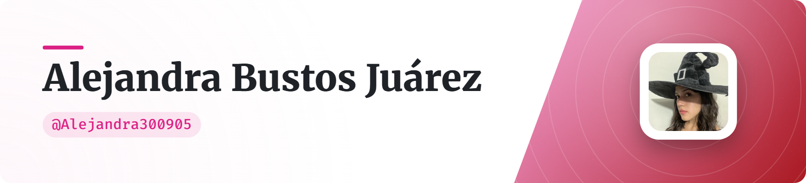

 
<picture>
  <source media="(prefers-color-scheme: dark)" srcset="art/header-dark.png">
  
</picture>

<h1 align="center">¡Hola! Soy Alejandra 👋</h1>

<h3 align="center">
  Estudiante de Inteligencia Artificial | Explorando, aprendiendo y construyendo
</h3>

  

  
  

---

## Sobre mí

Soy estudiante de la **Licenciatura en Inteligencia Artificial en la Universidad Autónoma del Estado de Morelos (UAEM)**.

Me interesa comprender cómo funcionan los sistemas inteligentes y cómo transformar los conocimientos teóricos en soluciones prácticas.

Actualmente estoy desarrollando habilidades en:

-  Machine Learning y Deep Learning.
-  Ciencia y análisis de datos.
-  Visión por computadora.
-  Procesamiento de Lenguaje Natural.

Me gusta aprender mediante proyectos y documentar mi proceso de aprendizaje.

---

## Áreas de interés

  
  
  
  
  
  

---

## Tecnologías y herramientas

### Lenguajes de programación

  

### Inteligencia Artificial y ciencia de datos

  
  
  
  

---

##  GitHub Stats

  
  

  

---

##  Mi actividad en GitHub

  

###  Mis contribuciones

  <picture>
    <source media="(prefers-color-scheme: dark)" srcset="https://raw.githubusercontent.com/Alejandra300905/Alejandra300905/output/github-contribution-grid-snake-dark.svg">
    <source media="(prefers-color-scheme: light)" srcset="https://raw.githubusercontent.com/Alejandra300905/Alejandra300905/output/github-contribution-grid-snake.svg">
    
  </picture>

---

## 🤝 Conectemos

Me interesa conectar con personas que disfruten aprender, desarrollar proyectos, compartir conocimientos y explorar nuevas posibilidades en tecnología e Inteligencia Artificial.

  
  
  

---

  

  <i>"Lo que importa no es lo que te sucede, sino cómo reaccionas ante ello."</i> 🌷

